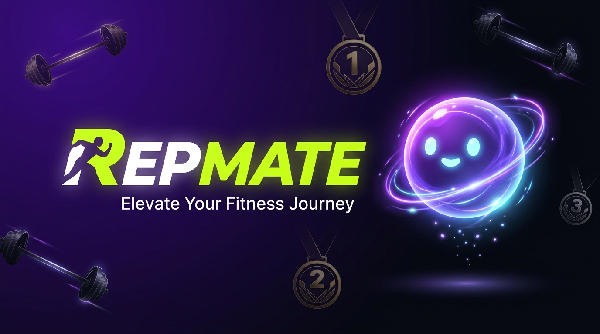

<div align="center">



# RepMate

**Your High-Contrast Gym Companion, Exact Workout Alarm & 3D Consistency Tracker for Android**

[-7C3AED?style=flat-square&logo=android&logoColor=white)](https://developer.android.com)
[-A3E635?style=flat-square)](#build--release)
[](https://kotlinlang.org)
[](https://developer.android.com/compose)
[](https://firebase.google.com)

*Concept by **fathan.** · Scripted by **Fathan, and Artificial Intelligence***

</div>

---

**RepMate** is a native Kotlin & Jetpack Compose Android application designed to keep lifters consistent from wake-up alarm to final cooldown set. Built around an expressive **Pulse** mascot companion, **7 distinctive OS-inspired UI themes**, an **all-3D perspective medal system**, a **327-exercise bilingual anatomy library**, and **offline-first Cloud Firestore sync**, RepMate adapts cleanly across phones, foldables, and low-end devices.

---

## Table of Contents

- [Core Features](#core-features)
- [7 OS Themes & 2 Lightweight Motion Presets](#7-os-themes--2-lightweight-motion-presets)
- [Tech Stack & Dependencies](#tech-stack--dependencies)
- [Architecture & Project Structure](#architecture--project-structure)
- [Android Permissions & Cloud Security](#android-permissions--cloud-security)
- [Build, Testing & CI/CD](#build-testing--cicd)

---

## Core Features

### 1. Phase-Aware Today Dashboard & Exact Workout Alarms
- **Time-of-Day Phase Engine:** Automatically shifts atmosphere gradients, card accents, and Pulse's pose across **Morning**, **Afternoon**, and **Night** phases.
- **Exact Alarm Scheduling:** Uses Android `AlarmManager` exact wakeups (`SCHEDULE_EXACT_ALARM`) paired with a lock-screen capable `AlarmRingActivity`, boot/timezone rescheduling (`BootCompletedReceiver`), customizable snooze intervals, and **5 native PCM synthesized ringtones** (`NativeAudioEngine`) plus custom user audio selection.
- **3-State Daily Readiness:** Displays tailored status cards for scheduled training days, completed/logged workouts, and active recovery days.

### 2. Dual Workout Experience: Gym Focus HUD & Standard Cockpit
- **Gym Focus HUD (`GymFocusHudStage`):** High-legibility stage built for mid-set glances on the gym floor, featuring big set counters, previous/next movement stepping, haptic cues (`HapticFeedbackHelper`), and live progress bars.
- **Standard Workout Cockpit (`WorkoutScreen`):** Detailed set-by-set tracking for weight, reps, notes, and quick completion toggles.
- **Foreground Rest Timer (`RestTimerService`):** Runs a persistent special-use foreground countdown notification between sets with configurable auto-start and dedicated rest chimes.

### 3. All-3D Monthly Medal System & 5-Second Celebration
- **Verified Monthly Consistency Rules:** Automatically audits workout logs so only genuine training days count (**>= 2 exercises**, **>= 6 paced sets**, and **>= 15 minutes** per day):
  - **Bronze Medal:** `12` verified gym days/month
  - **Silver Medal:** `16` verified gym days/month
  - **Gold Medal:** `20` verified gym days/month
- **True Multi-Axis 3D Emblem (`ProceduralMedalEmblem`):** Extruded metallic rim layers, specular sweeps, dynamic bevel shading, and a minted **`RM`** reverse crest rendered with perspective `cameraDistance`, `yawDegrees`, `pitchDegrees`, and `rollDegrees`.
- **5-Second Unlock Showcase & Parabolic 3D Flight:** Unlocking a tier triggers a 5-second celebration (`MedalUnlockCelebrationOverlay`) where the coin launches into a fast multi-turn 3D spin before smoothly decelerating dead-front alongside confetti rays and cheering Pulse—then banks along a curved 3D trajectory (`FlyingMedalOverlay`) straight into the History showcase slot with a shockwave burst and 3D landing rebound.
- **Interactive History & Settings Preview (`Interactive3DMedalEmblem`):** Medals in **History** gently float with ambient 3D tilt, respond to touch-drag orbit across yaw/pitch, and spin 360° on tap. Settings includes a non-destructive 3D celebration preview for Bronze, Silver, and Gold.

### 4. Pulse Mascot Companion (Partner & Coach Modes)
- **Adaptive Personality Engine:** Switch between **Partner** (friendly gym buddy) and **Coach** (structured intensity), each backed by **100+ bilingual (`ID`/`EN`) dialogues** and **10+ facial/body expressions** (`MascotDialogues`, `CoachMascotDialogues`).
- **Per-Letter Fade-In & Smooth Fade-Out Speech:** Speech headlines and sublines reveal character-by-character via smooth `AnnotatedString` alpha feathering (`0.04f -> 1.0f`) and cross-fade cleanly out (`115ms`) on transitions without distracting cursor artifacts.
- **Tactile & Voice Support:** Pet or drag the Pulse orb with spring physics, trigger optional offline Android `TextToSpeech` playback (`MascotTtsSpeaker`), and learn the interface through an interactive mascot tutorial (`PulseMascotTutorialOverlay`).

### 5. 7-Day Split Planner & 327-Exercise Muscle Anatomy Library
- **Flexible Weekly Scheduler (`ScheduleScreen`):** Configure `mon`–`sun` training focus titles, rest days, per-day alarm times, ringtone overrides, and switch between multi-day program presets (`ScheduleProgramSwitcher`, `ProgramTemplatePresets`).
- **327 Built-In Exercises (`GymPresets` + `ExerciseLibraryExtended`):** Fast bilingual search index covering strength, hypertrophy, bodyweight, and mobility movements.
- **Interactive Muscle Anatomy Diagrams (`MuscleAnatomyDiagram`):** Front and back anatomical vector overlays highlight primary and secondary muscle groups alongside equipment tags and form tips.

### 6. Bilingual UI, Performance Controls & Custom Accent Engine
- **Instant Language Switching:** Complete **Indonesian (`ID`)** and **English (`EN`)** localization across UI, exercise catalog, mascot speech, and workout logs.
- **Low-End & Accessibility Toggles (`PerformancePreferences`):** Independent switches for disabling animations (`noAnimations`), disabling ambient glow (`noAmbientGlow`), static mascot mode (`staticMascot`), and custom accent color picking (`VisualColorPickerDialog`).

---

## 7 OS Themes & 2 Lightweight Motion Presets

Every UI surface—including top/bottom chrome, mascot orb palettes, icons (`ThemeIcons.kt`), and custom brand wordmarks (`ThemeLogos.kt`)—adapts dynamically to the active theme:

| Category | Theme (`UiTheme`) | Visual Signature |
| :--- | :--- | :--- |
| **Standard** | **Material You (M3)** | Adaptive tonal surfaces with customizable accent palette (`RepMate Lime` default) & orbital monogram crest |
| **Standard** | **Carbon Forge** | Industrial brushed dark carbon steel paired with high-visibility forge amber/lime telemetry |
| **Standard** | **AMOLED Stealth** | Pure `#000000` power-saving OLED canvas with razor-sharp contrast borders |
| **Exclusive OS** | **Ubuntu Yaru** | Warm canonical aubergine surfaces, Yaru orange highlights, and crisp Linux-inspired pill geometry |
| **Exclusive OS** | **Frutiger Aero (Y2K)** | Early-2000s glossy aqua glass, luminous sky gradients, and high-contrast crisp ink typography |
| **Exclusive OS** | **XMaterial You** | Expressive color-blocked editorial containers with bold rounded badges and vibrant surface contrast |
| **Exclusive OS** | **Android Nougat 7.0** | Classic Android 7.0 slate-teal Material chrome featuring a dedicated `7.0` header version chip |

### Lightweight Motion Presets (`MotionTransitionStyle`)
- **`Silk Glide`:** Clean horizontal directional transitions with low overdraw.
- **`Elastic Pop`:** Expressive vertical spring-inspired scale and reveal motion.

---

## Tech Stack & Dependencies

| Layer | Technology / Library | Version |
| :--- | :--- | :--- |
| **Language** | Kotlin | `2.2.10` |
| **Android Gradle Plugin** | AGP | `9.1.1` |
| **Gradle Wrapper / Build Tool** | Gradle (system `gradle`) | `9.3.1` (`JDK 21`) |
| **SDK Targets** | `minSdk 24` / `compileSdk 36` / `targetSdk 36` | Android 7.0 – 16 |
| **UI Toolkit** | Jetpack Compose (`androidx.compose:compose-bom`) + Material 3 + Material Icons Extended | `2025.05.00` |
| **Navigation & Lifecycle** | Navigation Compose (`2.8.9`), Lifecycle Runtime/Compose/ViewModel (`2.8.7`), Core SplashScreen (`1.2.0`) | `2.8.x` |
| **Concurrency** | Kotlinx Coroutines Android & Play Services | `1.9.0` |
| **Backend & Identity** | Firebase BOM (`34.1.0`: Auth + Firestore), Jetpack Credentials (`1.5.0`), Google ID (`1.1.1`) | `34.1.0` / `1.5.0` |
| **Performance** | `androidx.profileinstaller` Baseline Profile support | `1.4.1` |
| **Testing** | JUnit (`4.13.2`), Robolectric (`4.16.1`), AndroidX Test Core (`1.6.1`), Compose UI Test JUnit4 | Local JVM CUJ Suite |

---

## Architecture & Project Structure

RepMate follows an **offline-first MVVM architecture** driven by a single source-of-truth `StateFlow<IronPulseUiState>` in `GymViewModel`:

```text
+-------------------------------------------------------------------+
|                   Jetpack Compose UI Layer                        |
|  Today · GymFocusHUD · Workout · Schedule · History · Exercises   |
|  Settings (6 Categories) · All-3D Medals · Pulse Mascot Overlay   |
+---------------------------------+---------------------------------+
                                  | collects StateFlow & triggers intents
                                  v
+-------------------------------------------------------------------+
|                     ViewModel Layer (`GymViewModel`)              |
|  Auth Gate · Theme & Motion State · Medal Eligibility Calculator  |
|  Speech Cooldown & Dialogue Picker · Alarm & Rest Timer Control   |
+----------------+---------------------------------+----------------+
                 |                                 |
                 v                                 v
+---------------------------------+ +-------------------------------+
|       Local & System Layer      | |     Cloud Persistence Layer   |
|  LocalGymCacheStore (offline    | |  Google Sign-In via Jetpack   |
|   cache + queued sync replay)   | |  CredentialManager + Firebase |
|  PreferencesStore · ProgramStore| |  Auth -> FirestoreGymRepo     |
|  AlarmScheduler · NativeAudio   | |  Zero-Trust `firestore.rules` |
+---------------------------------+ +-------------------------------+
```

```text
.
├── .github/workflows/android-apk.yml        # Automated unit tests, Debug/Release APKs & tag releases
├── app/
│   ├── build.gradle.kts                     # App configuration (namespace com.fathan.ironpulse, appId com.aistudio.ironpulse.k7m2xp)
│   └── src/
│       ├── main/
│       │   ├── AndroidManifest.xml          # Permissions, BootCompletedReceiver, AlarmRingActivity, RestTimerService
│       │   ├── res/
│       │   │   ├── drawable/                # Custom purple-to-black + Pulse orb/barbell adaptive launcher XMLs
│       │   │   ├── mipmap-*/                # Generated launcher & round PNG fallbacks (mdpi -> xxxhdpi)
│       │   │   └── values/                  # Strings (app_name = RepMate), themes & splash styles
│       │   └── java/com/fathan/ironpulse/
│       │       ├── alarm/                   # AlarmScheduler, GymAlarmReceiver, BootCompletedReceiver, AlarmRingActivity
│       │       ├── audio/                   # NativeAudioEngine (5 PCM synth tones) & MascotTtsSpeaker
│       │       ├── data/                    # GymPresets (167), ExerciseLibraryExtended (160), MascotDialogues,
│       │       │                            # CoachMascotDialogues, FirestoreGymRepository, LocalGymCacheStore,
│       │       │                            # PreferencesStore, ScheduleProfileStore, ProgramTemplatePresets
│       │       ├── lib/                     # HapticFeedbackHelper
│       │       ├── model/                   # GymModels, MedalModels, MuscleAnatomy, ScheduleProgramModels
│       │       ├── timer/                   # RestTimerService (specialUse foreground service)
│       │       ├── ui/
│       │       │   ├── components/          # MedalComponents (all-3D), MascotComponents (per-letter fade),
│       │       │   │                        # ChromeAndClock, Motion, MuscleAnatomyDiagram, ThemeIcons,
│       │       │   │                        # ThemeLogos, LaunchAndModals, VisualColorPickerDialog
│       │       │   ├── screens/             # TodayScreen, GymFocusHudStage, WorkoutScreen, ScheduleScreen,
│       │       │   │                        # HistoryScreen, ExercisesScreen, SettingsScreen, AuthScreen
│       │       │   ├── theme/               # MaterialYouPalette, Theme, ThemeTypography
│       │       │   ├── viewmodel/           # GymViewModel
│       │       │   └── IronPulseRoot.kt
│       │       ├── IronPulseApp.kt
│       │       └── MainActivity.kt
│       └── test/java/com/fathan/ironpulse/
│           └── StartupSmokeTest.kt          # Robolectric CUJ, theme contrast, 3D medal & mascot tests
├── docs/images/repmate-hero-banner.jpg      # RepMate hero banner graphic
├── firestore.rules                          # Verified-owner & strict schema-validated Firestore rules
└── gradle/libs.versions.toml                # Centralized version catalog
```

---

## Android Permissions & Cloud Security

### Declared Permissions (`AndroidManifest.xml`)
| Permission | Purpose |
| :--- | :--- |
| `INTERNET`, `ACCESS_NETWORK_STATE` | Firebase Authentication & Cloud Firestore synchronization |
| `SCHEDULE_EXACT_ALARM`, `RECEIVE_BOOT_COMPLETED`, `WAKE_LOCK` | Precise gym workout alarms that survive reboots and timezone changes |
| `USE_FULL_SCREEN_INTENT`, `VIBRATE` | Lock-screen workout alarm ring UI (`AlarmRingActivity`) and tactile alerts |
| `POST_NOTIFICATIONS` | Runtime notification alerts for exact workout reminders and active rest timers |
| `FOREGROUND_SERVICE`, `FOREGROUND_SERVICE_SPECIAL_USE` | Reliable background rest countdown notification between gym sets (`RestTimerService`) |

### Zero-Trust Cloud Security (`firestore.rules`)
- **Default Deny:** Global wildcard rule blocks all unauthenticated or unrecognized document access (`allow read, write: if false`).
- **Verified Owner Isolation:** Reads and writes under `/users/{userId}`, `/schedules/{dayKey}`, `/workoutLogs/{dateKey}`, and `/ringtones/{ringtoneId}` require `request.auth.uid == userId` and `request.auth.token.email_verified == true`.
- **Immutable Keys & Field Schemas:** Enforces strict allowlists (`hasAll`/`hasOnly`), bounded field sizes, regex-checked day/date IDs, immutable `createdAt`/`userId`, and server-time bounds (`<= request.time`).

---

## Build, Testing & CI/CD

### Prerequisites
- **JDK 21** and **Android SDK 36** (`ANDROID_SDK_ROOT` configured; **do not** create or rely on `local.properties`).
- **Gradle 9.3.1** installed as `gradle` on `PATH` (use `gradle`, not `./gradlew`).
- **Firebase Config (`app/google-services.json`):** Provide a valid Firebase Android config matching `applicationId = "com.aistudio.ironpulse.k7m2xp"` and your signing keystore SHA-1/SHA-256 fingerprints for live Google Sign-In.

### Local Commands
```bash
# Run the full unit & Robolectric Compose CUJ test suite
gradle :app:testDebugUnitTest --no-daemon --console=plain

# Build Debug & minified Release APKs
gradle :app:assembleDebug :app:assembleRelease --no-daemon --console=plain
```

### GitHub Actions CI/CD (`.github/workflows/android-apk.yml`)
Triggered on pushes to `main`, `v*` version tags, or manual `workflow_dispatch`:
1. Configures **JDK 21**, **Android SDK 36**, and **Gradle 9.3.1** with cached Robolectric dependencies.
2. Prepares `debug.keystore` (from `DEBUG_KEYSTORE_BASE64`, repo fallback, or ephemeral generation) and Firebase config (from `GOOGLE_SERVICES_JSON` and `FIRESTORE_DATABASE_ID`, or CI fallback for compilation & tests).
3. Runs `gradle :app:testDebugUnitTest` and builds `:app:assembleDebug` + `:app:assembleRelease`.
4. Uploads `ironpulse-release-apk`, `ironpulse-debug-apk`, and `unit-test-reports` artifacts, and automatically publishes GitHub Releases on `v*` tags.
